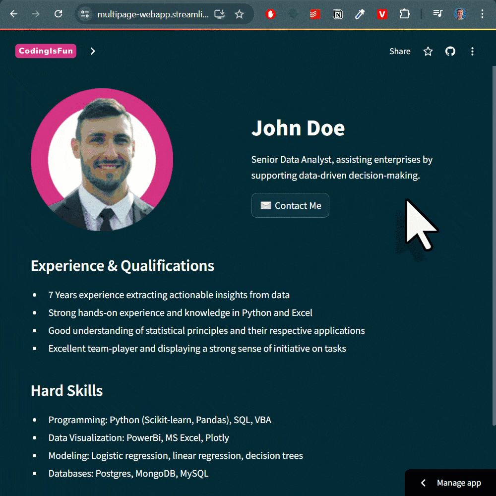

# 💻 Python Multi-Page Web App (Streamlit)

Build a multipage web application using only Python—no HTML, CSS, or JavaScript needed. Highlights of this web app include an easy-to-use navigation menu for switching between different pages and a fully functional modal contact form window.
.<br>
👉 **Check out the live website here:** [LIVE WEBSITE](https://multipage-webapp.streamlit.app/)

## Video Tutorial
[](https://youtu.be/9n4Ch2Dgex0)

## Dashboard Demo


## Run the app
```Powershell
# vanilla terminal
streamlit run streamlit_app.py

# quit
ctrl-c
```

## Learn Excel Automation with Python
If this repo helped you, my [Excel Automation Course](https://pythonandvba.com/excel-automation-course/) teaches the full workflow from zero: Python for Excel users, xlwings, pandas and real projects.

Also check out my other [tools and templates](https://pythonandvba.com/solutions).

## Connect with Me
- **YouTube:** [CodingIsFun](https://youtube.com/c/CodingIsFun)
- **Website:** [PythonAndVBA](https://pythonandvba.com)
- **LinkedIn:** [Sven Bosau](https://www.linkedin.com/in/sven-bosau/)
- **Contact:** [Get in Touch](https://pythonandvba.com/contact)
## ☕️ Support My Work
Love my content and want to show appreciation? Why not [buy me a coffee](https://pythonandvba.com/coffee-donation) to fuel my creative engine? Your support means the world to me! 😊

[](https://pythonandvba.com/coffee-donation)

## 💌 Feedback
Got some thoughts or suggestions? Don't hesitate to reach out to me at contact@pythonandvba.com. I'd love to hear from you! 💡

